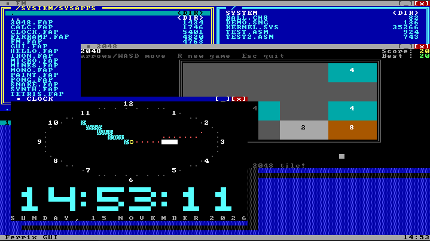
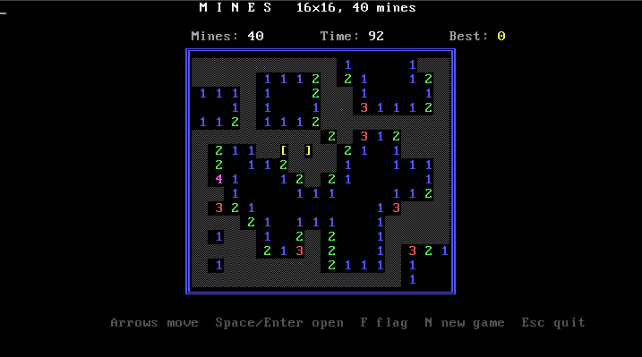

# Ferrix OS

16-битная операционная система для x86 в реальном режиме, написанная на NASM.
Загружается с дискеты 1.44 МБ (FAT12) или с жёсткого диска / USB-флешки до 32 МБ (FAT16),
работает поверх BIOS, умеет читать и писать FAT, имеет цветную командную оболочку с историей
и Tab-дополнением, набор программ и игр.

```
==========================================================
       ███████ ███████ ██████  ██████  ███████ ██   ██
       ██      ██      ██   ██ ██   ██   ███    ██ ██
       █████   █████   ██████  ██████    ███     ███
       ██      ██      ██  ██  ██  ██    ███    ██ ██
       ██      ███████ ██   ██ ██   ██ ███████ ██   ██
                    |Ferrix OS v4.0|
==========================================================
 Ready. Type 'help'.

neo@ferrix ~ » ls
```

## Скриншоты

| gui: fm, 2048 и clock в окнах | mines |
|---|---|
|  |  |

Ещё: [clock](screenshots/clock.png) · [synth](screenshots/synth.png) · [2048](screenshots/2048.png) · [pong](screenshots/pong.png)

## Возможности

- **Ядро** — один бинарник ~34 КБ, 16-bit real mode, зависит только от BIOS; работает на 8086/286 (32-битные инструкции не используются без проверки CPU)
- **Файловая система** — FAT12 и FAT16 с записью: файлы, вложенные каталоги, пути `a/b`, `../x`, `/`; длинные имена показываются в `ls -l`
- **Оболочка `fsh`** — ~35 команд, история (↑/↓), редактирование строки, Tab-дополнение команд и путей, скрипты `.SH` и `/SYSTEM/AUTOEXEC.SH`, мастер первого запуска (имя, часовой пояс, заставка)
- **Программы `.FAP`** — плоские 16-битные образы, запускаются по имени, общаются с ядром через `int 80h` (36 вызовов: экран, клавиатура, мышь, файлы, каталоги, время, звук, окна)
- **Мультимедиа** — `view` (BMP 8/24/32 бит), `play` (WAV через Intel HD Audio или Sound Blaster 16), синтезатор `synth`, плеер `ferramp`
- **Оконная оболочка `gui`** — до трёх окон с программами, мышь, обои из BMP

## Программы (`/SYSTEM/SYSAPPS`)

| Команда | Что это |
|---------|---------|
| `fm` | Двухпанельный файловый менеджер в духе Norton Commander (мышь, пометки, F1–F10) |
| `mono FILE` | Полноэкранный текстовый редактор |
| `calc [-g] [EXPR]` | Калькулятор: выражение, диалог или окно с кнопками |
| `paint [FILE.BMP]` | Рисовалка 80×23, 16 цветов, сохраняет BMP |
| `gui` | Рабочий стол / оконный менеджер |
| `clock` | Аналоговые часы на весь экран, большие цифры и дата |
| `ferramp [DIR\|FILE]` | Музыкальный проигрыватель WAV/SNG с плейлистом |
| `synth [FILE.SNG]` | Синтезатор-пианино с секвенсором (HD Audio) |
| `micro FILE.CH8` | Эмулятор CHIP-8 (`micro /BALL.CH8`) |
| `iron SRC.ASM OUT.FAP` | Компилятор ассемблера frasm → `.FAP` прямо в системе |
| `snake`, `tetris`, `mines`, `2048`, `pong` | Игры с рекордами на диске |

Встроенные команды ядра: `ls dir cd pwd cat touch write rm mkdir rename cp mv run sh fetch cpu mem date
time user whoami tz setup saver reboot shutdown view play echo hex bin ascii matrix clear banner osinfo credits help`.
`help` показывает группы, `help files` — команды группы, `help cat` — одну команду.

## Сборка и запуск

Нужны `nasm`, `dosfstools`, `mtools` и `qemu-system-i386`:

```bash
sudo apt install nasm dosfstools mtools qemu-system-x86   # Debian / Ubuntu
./build.sh            # hd.img — жёсткий диск 32 МБ FAT16, затем запуск QEMU
./build.sh floppy     # os.img — дискета 1.44 МБ FAT12
```

Запуск вручную (звук: PC speaker + SB16 + HD Audio; вместо `alsa` можно `pa` или `sdl`):

```
qemu-system-i386 -drive file=hd.img,format=raw,if=ide -boot c -audiodev alsa,id=snd0 \
    -machine pcspk-audiodev=snd0 -device sb16,audiodev=snd0 -device intel-hda -device hda-output,audiodev=snd0
```

Без `mtools`/`dosfstools` образ собирает `tools/mkdisk.py` (чистый Python):
`python3 tools/mkdisk.py hd.img --hd --boot boot.bin --kernel kernel.bin --sysapps build --root examples/*`.

Свои файлы на диск: `mcopy -i hd.img file.txt ::FILE.TXT` (имена 8.3, заглавными).

**Реальное железо**: флешка — `sudo dd if=hd.img of=/dev/sdX bs=512 && sync` (весь диск, не раздел;
загрузка в режиме Legacy/CSM, USB-HDD или USB-FDD), дискета — `dd if=os.img of=/dev/fd0`.
Образ — «суперфлоппи» без таблицы разделов; геометрия диска берётся у BIOS.

## Структура проекта

```
boot.asm        загрузчик (boot-сектор FAT12/FAT16, грузит KERNEL.SYS)
kernel.asm      ядро + оболочка (один файл)
fapi.inc        заголовок .FAP и номера системных вызовов
apps/           программы: fm mono calc paint gui clock ferramp synth micro iron
                игры snake tetris mines 2048 pong, пример hello; game.inc — помощники для игр
tools/          mkdisk.py — сборка образа; fpy.py — компилятор языка ferpy → frasm
examples/       TEST.ASM, TEST2.ASM (frasm), BALL.CH8 (CHIP-8), DEMO.SNG (synth), *.fpy
docs/           документация (ниже)
build.sh        сборка и запуск в QEMU
```

## Документация

- [docs/COMMANDS.md](docs/COMMANDS.md) — все команды оболочки с описанием, горячие клавиши
- [docs/APPS.md](docs/APPS.md) — программы подробно: fm, mono, gui, ferramp, synth, micro, iron и язык frasm
- [docs/FAPI.md](docs/FAPI.md) — формат `.FAP` и системные вызовы `int 80h` — как писать свои программы
- [docs/FERPY.md](docs/FERPY.md) — язык ferpy (Python-подобный → frasm → iron)
- [docs/INTERNALS.md](docs/INTERNALS.md) — контракт загрузчика и ядра, карта памяти, раскладка тома, известные ограничения

## Лицензия

MIT — см. [LICENSE](LICENSE). © 2026 Grushdeck.
